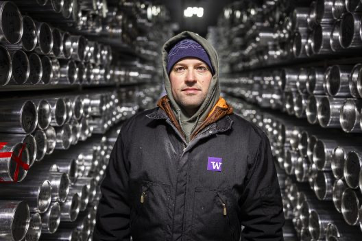

I mentored UW undergraduate Hailey Smith through the College of the Environment’s Identity, Belonging and Inquiry in Science program. In April, Hailey and I measured electrical conductivity along ice cores from Antarctica’s Allan Hills at the NSF Ice Core Facility near Denver. In some cores, we found sharp transitions where ice just centimeters apart could differ in age by millions of years.

Hailey shared her findings at UW’s Undergraduate Research Symposium in May. The [UW College of the Environment story and video](https://environment.uw.edu/news/2026/06/undergrad-researcher-studies-some-of-earths-oldest-ice/) follow her from the freezer to the symposium.

{fig-alt="Liam Kirkpatrick standing between racks of archived ice cores"}
